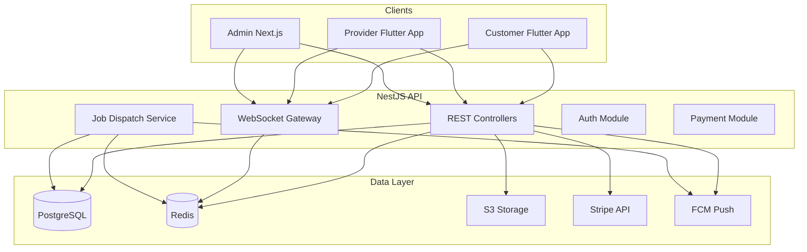
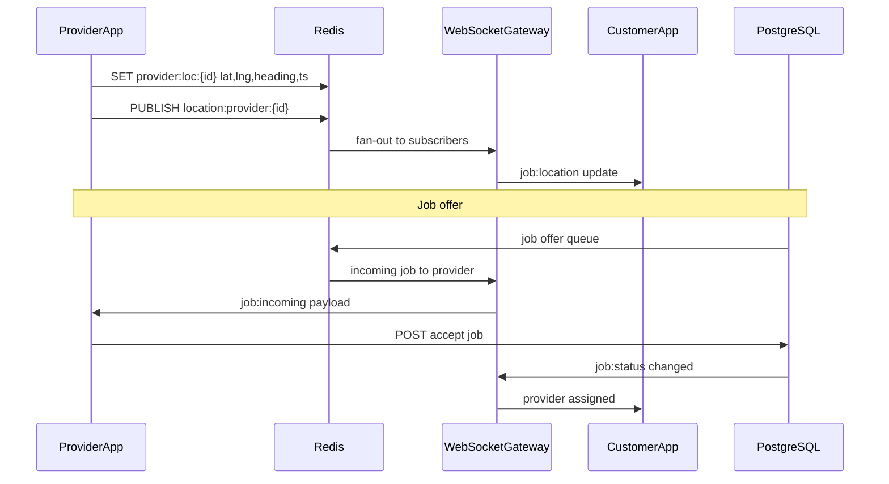
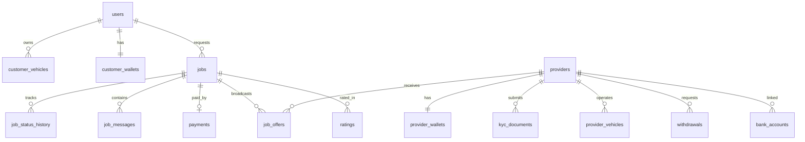

# Ryvo Platform — Backend & Admin Panel Developer Documentation

> Source plan: `ryvo_backend_admin_docs_e569dace.plan.md`

## 1. Scope & Stack

| Layer | Technology |
|-------|------------|
| Customer app | Flutter (`ryvo-customer`) — 22 routes, Phase 1 UI only |
| Provider app | Flutter (`ryvo_driver`) — 25+ routes, Phase 2 scaffolding with partial REST paths |
| Admin frontend | **Next.js** (App Router) |
| Backend API | **NestJS** modular monolith (`/api/v1`) |
| Database | **PostgreSQL 16** |
| Cache / pub-sub | **Redis 7** |
| Live tracking | **NestJS WebSocket Gateway** + Redis pub/sub |
| Payments | **Stripe** (card + wallet top-up) |
| Push | FCM (store tokens in Postgres) |
| File storage | S3-compatible (KYC docs, vehicle photos) |

**v1 decisions (confirmed):**
- Auth: phone + password login; OTP for register, verify phone, reset password
- Payments: Wallet + Stripe card only (Cash removed from v1 backend even though customer UI shows it)

**Source of truth for features:** Flutter routes and mock fields in both apps, especially:
- Customer: `ryvo_customer_app_0a46c735.plan.md`, `lib/core/router/app_router.dart`
- Provider: `lib/core/router/app_router.dart`, domain entities under `lib/features/*/domain/entities/`

---

## 2. High-Level Architecture



### Real-time flow (live tracking + job dispatch)



---

## 3. PostgreSQL Database Design

### 3.1 Core identity tables

#### `users` (customers)
| Column | Type | Notes |
|--------|------|-------|
| id | UUID PK | |
| full_name | VARCHAR(120) | from RegisterPage |
| phone | VARCHAR(20) UNIQUE | E.164 |
| password_hash | VARCHAR | bcrypt |
| email | VARCHAR NULL | optional |
| avatar_url | TEXT NULL | |
| rating_avg | DECIMAL(3,2) DEFAULT 0 | profile: 4.8 |
| trips_count | INT DEFAULT 0 | profile: 12 |
| status | ENUM active,suspended,deleted | admin control |
| created_at, updated_at | TIMESTAMPTZ | |

#### `providers`
| Column | Type | Notes |
|--------|------|-------|
| id | UUID PK | |
| full_name | VARCHAR(120) | register: name |
| phone | VARCHAR(20) UNIQUE | |
| email | VARCHAR(120) | register: email |
| password_hash | VARCHAR | |
| avatar_url | TEXT NULL | |
| rating_avg | DECIMAL(3,2) DEFAULT 0 | performance: 4.9 |
| total_trips | INT DEFAULT 0 | |
| acceptance_rate | DECIMAL(5,2) | performance mock: 94% |
| completion_rate | DECIMAL(5,2) | 98% |
| kyc_status | ENUM pending,approved,rejected | gates `/home` |
| is_online | BOOLEAN DEFAULT false | synced with Redis |
| status | ENUM active,suspended,deleted | |
| fcm_token | TEXT NULL | |
| created_at, updated_at | TIMESTAMPTZ | |

#### `admin_users`
| Column | Type | Notes |
|--------|------|-------|
| id | UUID PK | |
| email | VARCHAR UNIQUE | admin login |
| password_hash | VARCHAR | |
| full_name | VARCHAR | |
| role_id | UUID FK | |
| status | ENUM active,disabled | |
| last_login_at | TIMESTAMPTZ | |

#### `admin_roles` + `admin_permissions` + `role_permissions`
RBAC for admin panel modules (see Section 6).

#### `otp_verifications`
| Column | Type |
|--------|------|
| id, phone, code_hash, purpose (register,reset,verify) |
| expires_at, consumed_at, attempts |

#### `refresh_tokens`
| Column | Type |
|--------|------|
| id, subject_type (user,provider,admin), subject_id |
| token_hash, expires_at, revoked_at |

---

### 3.2 Vehicle tables

#### `customer_vehicles`
| Column | Type | Notes |
|--------|------|-------|
| id | UUID PK | |
| user_id | UUID FK users | |
| make, model | VARCHAR | Toyota, Camry |
| year | SMALLINT | 2022 |
| license_plate | VARCHAR | ABC-1234 |
| photo_url | TEXT NULL | |
| is_primary | BOOLEAN | |
| created_at | TIMESTAMPTZ | |

#### `provider_vehicles`
| Column | Type | Notes |
|--------|------|-------|
| id | UUID PK | |
| provider_id | UUID FK | |
| make, model, year | | VehicleInfoPage |
| plate_number | VARCHAR | NYC-4821 |
| color | VARCHAR NULL | assigned card: White |
| is_active | BOOLEAN | |

---

### 3.3 Service catalog & pricing

#### `service_types`
| Column | Type | Notes |
|--------|------|-------|
| id | UUID PK | |
| code | VARCHAR UNIQUE | jump_start, flat_tire, fuel, towing |
| name | VARCHAR | Jump Start Service |
| description | TEXT | Vehicle battery jump start assistance |
| icon | VARCHAR | material icon key |
| base_fare | DECIMAL(10,2) | $25.00 |
| is_active | BOOLEAN | admin toggle |

#### `pricing_rules`
| Column | Type |
|--------|------|
| id, service_type_id FK |
| per_km_rate, service_fee_pct, tax_pct |
| min_fare, surge_multiplier |
| effective_from, effective_to |

---

### 3.4 Jobs (central entity)

#### `jobs`
| Column | Type | Notes |
|--------|------|-------|
| id | UUID PK | |
| job_ref | VARCHAR UNIQUE | JMP-2847 |
| customer_id | UUID FK | |
| provider_id | UUID FK NULL | assigned after accept |
| vehicle_id | UUID FK customer_vehicles | |
| service_type_id | UUID FK | |
| status | ENUM | see lifecycle below |
| is_high_priority | BOOLEAN | incoming sheet flag |
| notes | TEXT NULL | service request notes |
| pickup_address | TEXT | 221 Baker Street... |
| pickup_lat, pickup_lng | DECIMAL(10,7) | |
| distance_km | DECIMAL(6,2) | 1.2 |
| eta_minutes | SMALLINT | 4 |
| book_now | BOOLEAN | true = immediate |
| scheduled_at | TIMESTAMPTZ NULL | Book Later |
| base_fare, distance_fee, service_fee, tax_amount | DECIMAL | price estimate |
| total_amount | DECIMAL(10,2) | $35.00 |
| payout_amount | DECIMAL(10,2) | provider earn $18.50 |
| platform_fee_amount | DECIMAL(10,2) | 10% from provider tx |
| payment_method | ENUM wallet, card | v1 only |
| payment_status | ENUM pending,paid,failed,refunded | |
| provider_rating | SMALLINT NULL | 1-5 post-job |
| customer_rating | SMALLINT NULL | provider rates customer |
| duration_seconds | INT NULL | 8 min 42 sec |
| search_started_at | TIMESTAMPTZ | searching phase |
| assigned_at, arrived_at, started_at, completed_at, cancelled_at | TIMESTAMPTZ | |
| cancel_reason | TEXT NULL | |
| cancelled_by | ENUM customer,provider,admin,system | |
| created_at, updated_at | TIMESTAMPTZ | |

**Job status enum (align customer + provider apps):**
`draft` → `searching` → `offered` → `accepted` → `navigating` → `arrived` → `in_progress` → `completed`
Branches: `cancelled`, `declined`, `expired`, `scheduled`

#### `job_status_history`
Audit trail: `job_id`, `from_status`, `to_status`, `actor_type`, `actor_id`, `note`, `created_at`

#### `job_offers`
Dispatch broadcast to providers:
| Column | Type |
|--------|------|
| id, job_id, provider_id |
| status (pending,accepted,declined,expired) |
| offer_expires_at (15 sec countdown) |
| distance_km, eta_minutes, payout_amount |
| responded_at |

---

### 3.5 Location (Postgres history + Redis live)

#### `provider_location_logs` (partitioned by month)
| Column | Type |
|--------|------|
| id, provider_id, lat, lng, heading, speed |
| recorded_at |

**Redis live keys (not in Postgres):**
- `provider:online:{providerId}` → `{ isOnline, updatedAt }` TTL 60s
- `provider:loc:{providerId}` → `{ lat, lng, heading, ts }` TTL 30s
- `geo:providers:online` → GEOADD for nearby search
- `job:offer:{jobId}:{providerId}` → offer payload TTL 15s
- `ws:session:{userId}` → socket connection metadata

---

### 3.6 Payments & wallets

#### `customer_wallets`
| Column | Type |
|--------|------|
| user_id PK FK | balance DECIMAL default 0, status active/frozen |

#### `provider_wallets`
| Column | Type |
|--------|------|
| provider_id PK FK | available DECIMAL, pending DECIMAL |

#### `wallet_transactions`
| Column | Type |
|--------|------|
| id, owner_type (user,provider), owner_id |
| type (top_up, job_payment, job_payout, refund, withdraw, adjustment) |
| amount, balance_after, credit BOOLEAN |
| reference_type (job,payment,withdrawal), reference_id |
| title, subtitle | matches wallet UI |
| created_at |

#### `payments`
| Column | Type |
|--------|------|
| id, job_id, user_id |
| method wallet/card |
| amount, currency |
| stripe_payment_intent_id NULL |
| status pending,succeeded,failed,refunded |
| created_at |

#### `bank_accounts`
| Column | Type |
|--------|------|
| id, provider_id, bank_name, account_holder |
| account_number_encrypted, last_four (4821) |
| is_primary, verified |

#### `withdrawals`
| Column | Type |
|--------|------|
| id, provider_id, bank_account_id |
| amount, status pending,approved,rejected,completed |
| reviewed_by admin FK, reviewed_at, note |

---

### 3.7 KYC

#### `kyc_documents`
| Column | Type |
|--------|------|
| id, provider_id |
| type license,registration,insurance |
| file_url, file_name |
| status not_uploaded,pending,verified,rejected |
| status_detail TEXT | rejection reason |
| reviewed_by, reviewed_at |

---

### 3.8 Chat, ratings, notifications

#### `job_messages`
| Column | Type |
|--------|------|
| id, job_id, sender_type, sender_id |
| text, delivery_status sent,delivered,read |
| created_at |

#### `ratings`
| Column | Type |
|--------|------|
| id, job_id, rater_type, ratee_type, ratee_id |
| stars 1-5, comment NULL |

#### `notifications`
| Column | Type |
|--------|------|
| id, recipient_type, recipient_id |
| title, body, type, data JSONB |
| read_at NULL, created_at |

#### `faqs`
| Column | Type |
|--------|------|
| id, audience customer/provider/both |
| question, answer, sort_order, is_active |

#### `audit_logs` (admin actions)
| Column | Type |
|--------|------|
| id, admin_id, action, entity_type, entity_id |
| before JSONB, after JSONB, ip, created_at |

---

### 3.9 ER relationships (key FKs)



---

## 4. REST API Specification

Base URL: `https://api.ryvo.com/v1`

Auth header: `Authorization: Bearer <access_token>`

Role-specific prefixes keep contracts clear for mobile teams.

### 4.1 Shared Auth APIs

| Method | Endpoint | Body | Used by |
|--------|----------|------|---------|
| POST | `/auth/customer/register` | fullName, phone, password | Customer |
| POST | `/auth/provider/register` | fullName, phone, email, password | Provider |
| POST | `/auth/otp/send` | phone, purpose | Both |
| POST | `/auth/otp/verify` | phone, code, purpose | Both |
| POST | `/auth/customer/login` | phone, password | Customer |
| POST | `/auth/provider/login` | phone, password | Provider |
| POST | `/auth/admin/login` | email, password | Admin |
| POST | `/auth/refresh` | refresh_token | All |
| POST | `/auth/password/reset` | phone, code, newPassword | Both |
| POST | `/auth/logout` | refresh_token | All |

Response shape: `{ accessToken, refreshToken, expiresIn, user|provider|admin }`

---

### 4.2 Customer App APIs

Derived from customer routes: home, service-request, price-estimate, searching, tracking, payment, wallet, bookings, profile.

#### Profile & vehicles
| Method | Endpoint | Purpose |
|--------|----------|---------|
| GET | `/customer/me` | Profile (name, phone, rating, trips, walletBalance) |
| PATCH | `/customer/me` | Update profile, avatar |
| GET | `/customer/vehicles` | List vehicles |
| POST | `/customer/vehicles` | make, model, year, licensePlate, photo |
| PATCH | `/customer/vehicles/:id` | Update |
| DELETE | `/customer/vehicles/:id` | Remove |
| POST | `/customer/vehicles/:id/primary` | Set primary |

#### Service & pricing
| Method | Endpoint | Purpose |
|--------|----------|---------|
| GET | `/customer/services` | Jump Start, Flat Tire, etc. |
| POST | `/customer/jobs/estimate` | serviceTypeId, pickupLat/Lng, vehicleId → breakdown |
| GET | `/customer/providers/nearby` | lat, lng, serviceTypeId → markers with eta, dist |

#### Jobs lifecycle
| Method | Endpoint | Purpose |
|--------|----------|---------|
| POST | `/customer/jobs` | Create job → status searching |
| GET | `/customer/jobs/:id` | Job detail + provider info |
| GET | `/customer/jobs` | Booking history (BookingsPage) |
| POST | `/customer/jobs/:id/cancel` | Cancel during search/en-route |
| POST | `/customer/jobs/:id/rate` | stars 1-5, comment |

#### Payments
| Method | Endpoint | Purpose |
|--------|----------|---------|
| GET | `/customer/wallet` | balance, status |
| GET | `/customer/wallet/transactions` | WalletPage list |
| POST | `/customer/wallet/top-up` | amount → Stripe PaymentIntent |
| POST | `/customer/payments/intent` | jobId, method card → Stripe |
| POST | `/customer/jobs/:id/pay` | method wallet|card |

#### Notifications
| Method | Endpoint | Purpose |
|--------|----------|---------|
| GET | `/customer/notifications` | List |
| PATCH | `/customer/notifications/:id/read` | Mark read |
| POST | `/customer/fcm-token` | Register device |

---

### 4.3 Provider App APIs

Derived from provider routes and existing REST stubs in earnings/wallet repositories.

#### Profile, vehicle, availability
| Method | Endpoint | Purpose |
|--------|----------|---------|
| GET | `/provider/me` | ProviderEntity fields |
| PATCH | `/provider/me` | PersonalInfoPage |
| GET/PATCH | `/provider/vehicle` | VehicleInfoPage |
| GET/POST/PATCH | `/provider/bank-accounts` | PaymentMethodsPage |
| POST | `/provider/availability/online` | Go online → start location stream |
| POST | `/provider/availability/offline` | Go offline |
| POST | `/provider/location` | lat, lng, heading (fallback if WS down) |

#### KYC
| Method | Endpoint | Purpose |
|--------|----------|---------|
| GET | `/provider/kyc/status` | documents + isApproved |
| POST | `/provider/kyc/documents` | type, file upload → S3 |
| GET | `/provider/kyc/documents/:type` | Document detail |

#### Jobs
| Method | Endpoint | Purpose |
|--------|----------|---------|
| GET | `/provider/jobs/incoming` | Poll fallback; primary via WS |
| POST | `/provider/jobs/:id/accept` | Accept incoming (15s window) |
| POST | `/provider/jobs/:id/decline` | Reject |
| GET | `/provider/jobs/active` | Current job |
| PATCH | `/provider/jobs/:id/status` | navigating, arrived, in_progress, completed |
| GET | `/provider/jobs/history` | JobHistoryPage |
| GET | `/provider/jobs/:id` | Detail |

#### Earnings & wallet
| Method | Endpoint | Purpose |
|--------|----------|---------|
| GET | `/provider/earnings/weekly` | weeklyTotal, jobCount, averageRating, dailyBreakdown[] |
| GET | `/provider/earnings/history` | Transaction list |
| GET | `/provider/transactions/:id` | gross, platformFee, net, date |
| GET | `/provider/wallet` | available, pending |
| POST | `/provider/wallet/withdraw` | amount, bank_account_id |

#### Chat, performance, notifications
| Method | Endpoint | Purpose |
|--------|----------|---------|
| GET | `/provider/jobs/:jobId/messages` | Chat history |
| POST | `/provider/jobs/:jobId/messages` | Send message |
| GET | `/provider/performance` | acceptance/completion rates, review breakdown |
| GET | `/provider/reviews` | Reviews list |
| GET | `/provider/notifications` | NotificationsPage |
| POST | `/provider/fcm-token` | Register device |
| GET | `/provider/faqs` | HelpSupportPage |

---

### 4.4 Admin Panel APIs

All under `/admin/*`, protected by admin JWT + RBAC.

#### Dashboard
| Method | Endpoint | Data |
|--------|----------|------|
| GET | `/admin/dashboard/kpis` | activeJobs, onlineProviders, todayRevenue, pendingKyc, pendingWithdrawals |
| GET | `/admin/dashboard/charts` | jobsOverTime, revenueOverTime, serviceBreakdown |

#### Customers
| Method | Endpoint | Admin UI action |
|--------|----------|-----------------|
| GET | `/admin/customers` | Table: search, filter status, date |
| GET | `/admin/customers/:id` | Detail drawer: profile, vehicles, jobs, wallet |
| PATCH | `/admin/customers/:id/status` | Suspend / activate |
| POST | `/admin/customers/:id/wallet/adjust` | Manual credit/debit + audit |

#### Providers
| Method | Endpoint | Admin UI action |
|--------|----------|-----------------|
| GET | `/admin/providers` | Table: KYC status, online, rating |
| GET | `/admin/providers/:id` | Full profile + vehicle + metrics |
| PATCH | `/admin/providers/:id/status` | Suspend, force offline |
| GET | `/admin/providers/:id/jobs` | Job history |
| GET | `/admin/providers/:id/performance` | Rates + reviews |

#### KYC queue
| Method | Endpoint | Admin UI action |
|--------|----------|-----------------|
| GET | `/admin/kyc/pending` | Review queue table |
| GET | `/admin/kyc/documents/:id` | View document |
| PATCH | `/admin/kyc/documents/:id` | Approve / reject + reason |
| PATCH | `/admin/providers/:id/kyc/approve` | Bulk approve when all docs verified |

#### Jobs & dispatch center
| Method | Endpoint | Admin UI action |
|--------|----------|-----------------|
| GET | `/admin/jobs` | Filter: status, service, date, customer, provider |
| GET | `/admin/jobs/:id` | Timeline from job_status_history |
| PATCH | `/admin/jobs/:id/status` | Manual override / cancel |
| POST | `/admin/jobs/:id/reassign` | Change provider |
| POST | `/admin/jobs/:id/refund` | Trigger refund |
| GET | `/admin/jobs/live` | Active jobs for dispatch board |

#### Live map
| Method | Endpoint | Admin UI action |
|--------|----------|-----------------|
| GET | `/admin/live/providers` | All online providers + lat/lng |
| GET | `/admin/live/jobs` | Active jobs with customer/provider pins |
| GET | `/admin/live/providers/:id/trail` | Recent location_logs |

#### Finance
| Method | Endpoint | Admin UI action |
|--------|----------|-----------------|
| GET | `/admin/payments` | All payments, filter method/status |
| GET | `/admin/transactions` | All wallet transactions |
| GET | `/admin/withdrawals` | Pending queue |
| PATCH | `/admin/withdrawals/:id` | Approve / reject |
| POST | `/admin/payments/:id/refund` | Stripe refund |

#### CMS & comms
| Method | Endpoint | Admin UI action |
|--------|----------|-----------------|
| CRUD | `/admin/services` | Service catalog + pricing |
| CRUD | `/admin/faqs` | FAQ management |
| POST | `/admin/notifications/broadcast` | Push to segment |
| GET | `/admin/jobs/:id/messages` | Chat moderation |

#### Admin management
| Method | Endpoint |
|--------|----------|
| CRUD | `/admin/users` (admin staff) |
| CRUD | `/admin/roles` |
| GET | `/admin/audit-logs` |

---

## 5. WebSocket Events (Redis-backed)

Gateway namespaces:
- `/ws/customer` — customer JWT
- `/ws/provider` — provider JWT
- `/ws/admin` — admin JWT

### Customer events
| Event | Direction | Payload |
|-------|-----------|---------|
| `job:subscribe` | C→S | jobId |
| `job:status` | S→C | jobId, status, timestamps |
| `job:provider_assigned` | S→C | provider profile + vehicle |
| `job:location` | S→C | providerId, lat, lng, eta, distanceKm |
| `job:completed` | S→C | jobId, total, durationSeconds |

### Provider events
| Event | Direction | Payload |
|-------|-----------|---------|
| `availability:online` | C→S | starts heartbeat |
| `location:update` | C→S | lat, lng, heading every 3-5s |
| `job:incoming` | S→C | full incoming sheet payload |
| `job:offer_expired` | S→C | jobId |
| `job:cancelled` | S→C | jobId, reason |

### Admin events
| Event | Direction | Payload |
|-------|-----------|---------|
| `live:subscribe` | C→S | optional filters |
| `live:provider_moved` | S→C | providerId, lat, lng |
| `live:job_updated` | S→C | job summary |

---

## 6. Admin Panel (Next.js) Module Design

### 6.1 Navigation structure

```
Dashboard
Operations
  ├── Live Map
  ├── Dispatch Board (active jobs)
  └── All Jobs
Users
  ├── Customers
  └── Providers
Compliance
  └── KYC Review Queue
Finance
  ├── Payments
  ├── Wallets
  └── Withdrawals
Content
  ├── Service Catalog
  └── FAQs
Engagement
  ├── Notifications
  └── Reviews
Settings
  ├── Admin Users & Roles
  ├── Pricing Rules
  └── Audit Logs
```

### 6.2 Key screens & table columns

| Module | Table columns | Row actions |
|--------|---------------|-------------|
| **Dashboard** | KPI cards + charts + mini live map | — |
| **Customers** | name, phone, trips, rating, wallet, status, joined | View, Suspend, Adjust wallet |
| **Providers** | name, phone, KYC, online dot, rating, trips, status | View, Force offline, Suspend |
| **KYC Queue** | provider, doc type, submitted, status | Preview doc, Approve, Reject |
| **Jobs** | ref, service, customer, provider, status, total, date | View timeline, Reassign, Cancel, Refund |
| **Live Map** | map + sidebar list of online providers | Click pin → provider detail |
| **Dispatch Board** | searching jobs, offered count, SLA timer | Manual assign provider |
| **Payments** | job ref, customer, method, amount, status, date | Refund |
| **Withdrawals** | provider, amount, bank, status, requested | Approve, Reject |
| **Services** | name, base fare, active | Edit pricing |
| **Reviews** | job, rater, ratee, stars, comment, date | Hide/delete |
| **Notifications** | title, audience, sent count, date | Create broadcast |
| **Admin Users** | name, email, role, last login | Edit role, Disable |

### 6.3 Admin roles (RBAC)

| Role | Modules |
|------|---------|
| Super Admin | All |
| Operations | Dashboard, Live Map, Jobs, Dispatch, Providers (read), Customers (read) |
| Compliance | KYC, Providers (read) |
| Finance | Payments, Wallets, Withdrawals, Transactions |
| Support | Customers, Providers, Jobs (read), Chat, Reviews |

---

## 7. Job Dispatch Algorithm (backend logic)

1. Customer `POST /customer/jobs` → status `searching`
2. Dispatch service queries Redis `GEORADIUS geo:providers:online` within X km, filters: KYC approved, not busy, matching service capability
3. Create `job_offers` rows; push `job:incoming` via WS; 15s TTL in Redis
4. First `accept` wins → job `accepted`, other offers `expired`
5. If no accept → retry next provider batch or status `expired`
6. Provider status updates drive customer WS events
7. On `completed` + payment success → credit `provider_wallets.pending`, then release to `available` after settlement window

---

## 8. Deliverable Document Structure for Backend Team

Recommended path in this repo: `docs/BACKEND_ADMIN_SPEC.md`

Sections:
1. **Overview & conventions** (naming, error format, pagination, idempotency)
2. **Database DDL** (PostgreSQL migrations via TypeORM/Prisma)
3. **Entity relationship diagram**
4. **Customer API reference** (OpenAPI YAML)
5. **Provider API reference** (OpenAPI YAML)
6. **Admin API reference** (OpenAPI YAML)
7. **WebSocket protocol doc**
8. **Redis key catalog**
9. **Job state machine diagram**
10. **Admin panel wireframe notes** (module → API mapping)
11. **Stripe integration flows** (top-up, job payment, refund)
12. **FCM notification triggers table**
13. **Security checklist** (JWT, RBAC, rate limits, PII encryption for bank accounts)

---

## 9. Mapping from Flutter apps → backend (quick reference)

| Customer screen | Primary APIs |
|-----------------|--------------|
| Register/OTP/Login | `/auth/customer/*`, `/auth/otp/*` |
| Add Vehicle | `/customer/vehicles` |
| Home + nearby providers | `/customer/providers/nearby` + WS |
| Service Request → Estimate | `/customer/jobs/estimate`, `POST /customer/jobs` |
| Searching / Assigned / Live tracking | WS `job:*` + `GET /customer/jobs/:id` |
| Payment / Success | `/customer/jobs/:id/pay`, `/customer/payments/intent` |
| Wallet / Top-up | `/customer/wallet/*` |
| Bookings | `GET /customer/jobs` |

| Provider screen | Primary APIs |
|-----------------|--------------|
| Register/OTP/KYC | `/auth/provider/*`, `/provider/kyc/*` |
| Home online + incoming job | WS `job:incoming`, `/provider/availability/*` |
| Accept → Navigation → Complete | `/provider/jobs/:id/accept`, `PATCH status` |
| Earnings / Transaction detail | `/provider/earnings/weekly`, `/provider/transactions/:id` |
| Wallet / Withdraw | `/provider/wallet`, `/provider/wallet/withdraw` |
| Chat | `/provider/jobs/:jobId/messages` + WS |
| Performance / Reviews | `/provider/performance`, `/provider/reviews` |

---

## 10. Implementation order for backend team

1. Postgres schema + migrations (Section 3)
2. Auth module (customer, provider, admin + OTP + refresh)
3. Service catalog + pricing + job estimate
4. Provider availability + location (REST + Redis GEO)
5. Job create + dispatch + accept/decline
6. WebSocket gateway + Redis pub/sub
7. Job status lifecycle + notifications (FCM)
8. Payments (Stripe) + wallets
9. KYC upload + admin review
10. Earnings, transactions, withdrawals
11. Chat messages
12. Admin APIs + audit logs
13. OpenAPI docs + Postman collection for mobile teams
