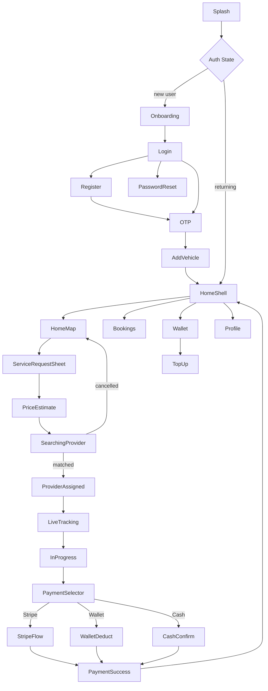

# Ryvo Customer App — Build Plan

## Project State
The workspace `/Users/rztutul/Documents/flutterproject/ryvo-customer` is an **empty directory** with no Flutter scaffolding. Everything must be initialized and built from scratch.

---

---

## PHASE 1 — Complete UI Build (Static / Mock Data)

> Goal: Every screen is navigable, visually pixel-perfect, and populated with hardcoded mock data. No real network calls or Firebase dependencies in this phase.

### 1A — Flutter Init & UI-Only Dependencies

Run `flutter create . --org com.ryvo --project-name ryvo_customer` then configure `pubspec.yaml` with UI-focused packages only:

**UI dependencies (Phase 1):**
- `go_router` — navigation and route declarations
- `google_fonts` — Poppins typography
- `google_maps_flutter` — map widget (static mock markers)
- `shimmer` — loading skeleton widgets
- `lottie` — splash, radar, and success animations
- `pin_code_fields` — OTP input widget
- `smooth_page_indicator` — onboarding page dots
- `image_picker` — vehicle photo selection (UI only)
- `flutter_riverpod` — lightweight UI state (selected tab, selected service chip, toggle states)

**Logic dependencies added in Phase 2:** Firebase, Dio, freezed, dartz, secure_storage, stripe, geolocator, geocoding, polyline_points

---

### 1B — Folder Structure (UI-First Layout)

```
lib/
├── core/
│   ├── theme/          # ThemeData, colors, text styles, spacing
│   ├── constants/      # API URLs, map keys, app strings
│   ├── errors/         # Failure sealed classes, exceptions
│   ├── network/        # Dio client, JWT interceptor, refresh logic
│   ├── router/         # GoRouter config, route guards, shell routes
│   └── utils/          # Extensions, validators, formatters
├── features/
│   ├── auth/
│   │   ├── data/       # AuthRemoteDataSource, UserModel, AuthRepoImpl
│   │   ├── domain/     # UserEntity, AuthFailure, IAuthRepo, UseCases
│   │   └── presentation/ # AuthNotifier, LoginPage, RegisterPage, OTPPage, ResetPage
│   ├── onboarding/
│   │   └── presentation/ # SplashPage, OnboardingPage
│   ├── vehicle/
│   │   ├── data/
│   │   ├── domain/
│   │   └── presentation/ # AddVehiclePage, VehicleListPage
│   ├── home/
│   │   └── presentation/ # HomeMapPage, BottomNavShell
│   ├── service_request/
│   │   ├── data/
│   │   ├── domain/
│   │   └── presentation/ # ServiceRequestSheet, PriceEstimatePage, SearchingPage
│   ├── tracking/
│   │   ├── data/       # Firestore real-time listeners
│   │   ├── domain/
│   │   └── presentation/ # ProviderAssignedPage, LiveTrackingPage, InProgressPage
│   ├── payment/
│   │   ├── data/
│   │   ├── domain/
│   │   └── presentation/ # PaymentSelectorPage, PaymentSuccessPage
│   ├── wallet/
│   │   ├── data/
│   │   ├── domain/
│   │   └── presentation/ # WalletPage, TopUpPage
│   └── profile/
│       └── presentation/ # ProfilePage
└── shared/
    ├── widgets/        # RyvoButton, RyvoTextField, RyvoBottomSheet, ShimmerCard
    └── providers/      # SharedProviders (user session, location stream)
```

### 1C — Design System

File: [`lib/core/theme/app_theme.dart`](lib/core/theme/app_theme.dart)

- `AppColors.primary = Color(0xFFF59E0B)` (amber accent)
- `AppColors.background = Color(0xFF0B0B0C)`
- `AppColors.surface = Color(0xFF141414)`
- `AppColors.modal = Color(0xFF1C1C1E)`
- `AppSpacing` constants: `8, 12, 16, 24, 32`
- `ThemeData.dark()` overriding `colorScheme`, `textTheme` (Poppins), `cardTheme`, `bottomSheetTheme`

### 1D — Shared Atomic Widgets

Built once, reused across all screens:
- `RyvoButton` — full-width amber CTA with loading state
- `RyvoTextField` — dark input field with amber focus ring + validation error display
- `RyvoBottomSheet` — styled modal sheet with drag handle
- `ShimmerCard` — placeholder loading skeleton
- `RyvoAppBar` — custom top bar (hamburger / logo / bell variants)

### 1E — Navigation Shell (GoRouter, mock guards)

```
GoRouter routes:
  /splash          → SplashPage
  /onboarding      → OnboardingPage
  /login           → LoginPage
  /register        → RegisterPage
  /otp             → OTPPage
  /reset-password  → PasswordResetPage
  /add-vehicle     → AddVehiclePage
  /shell (ShellRoute — bottom nav)
    /home          → HomeMapPage
    /bookings      → BookingsPage
    /wallet        → WalletPage
    /profile       → ProfilePage
  /service-request → ServiceRequestSheet
  /price-estimate  → PriceEstimatePage
  /searching       → SearchingPage
  /provider-assigned → ProviderAssignedPage
  /live-tracking   → LiveTrackingPage
  /in-progress     → InProgressPage
  /payment         → PaymentSelectorPage
  /payment-success → PaymentSuccessPage
  /top-up          → TopUpPage
```

Auth guard is a simple `StateProvider<bool>` flag in Phase 1 (toggled on login tap).

### 1F — All Screens (with mock data)

Complete screen flow:



**Screen-by-screen spec:**

**Auth & Onboarding:**
- **SplashPage**: Animated Ryvo logo, 2s delay → navigates to Onboarding or Home
- **OnboardingPage**: 3-slide `PageView`, `SmoothPageIndicator` dots, amber "Get Started" button
- **LoginPage**: Phone number field + Password field, "Forgot password?" link, "Sign up" link
- **RegisterPage**: Full Name + Phone Number + Password fields only (no email); amber "Create Account" button
- **OTPPage**: `PinCodeTextField` 6-digit, 60s countdown timer, "Resend" link
- **PasswordResetPage**: Phone number field, amber submit button
- **AddVehiclePage**: Make / Model / Year / Plate fields + photo upload via `ImagePicker`

**Home (matches reference design image):**
- **HomeMapPage** — two-layer layout:
  - Full-screen `GoogleMap` with mock "You" marker + 4 mock provider car markers with ETA chips
  - Top bar overlay: hamburger (left) | logo pill (center) | notification bell with "3" badge (right)
  - `DraggableScrollableSheet` bottom panel containing:
    - Provider count row: amber dot + "4 providers nearby" | green "Verified & Trusted" badge
    - "What do you need help with?" — horizontal service chips (Jump Start selected, Flat Tire, Fuel Delivery, Towing, More)
    - Location row with mock address + pencil edit icon
    - Book Now / Book Later radio toggle
    - Full-width amber CTA: lightning bolt + "Request Jump Start"

**Service Flow:**
- **ServiceRequestSheet**: Multi-step bottom sheet (service type → notes → confirm)
- **PriceEstimatePage**: Mock fare breakdown + payment method selection chips
- **SearchingPage**: Lottie radar/pulse animation (looping), amber "Cancel" button

**Tracking:**
- **ProviderAssignedPage**: Mock provider card (avatar, name "John D.", rating 4.8★, plate "NYC-1234"), mock ETA timer
- **LiveTrackingPage**: `GoogleMap` with static polyline + mock moving marker
- **InProgressPage**: Animated progress steps, mock elapsed timer

**Payment:**
- **PaymentSelectorPage**: Three cards — Stripe, Wallet ($42.50 mock balance), Cash
- **PaymentSuccessPage**: Lottie checkmark, mock job summary, "Back to Home" button

**Wallet & Profile:**
- **WalletPage**: Mock $42.50 balance card, shimmer transaction list (5 mock entries), "Top Up" button
- **TopUpPage**: Preset amount chips ($10, $20, $50, $100) + custom amount input
- **ProfilePage**: Mock user info, vehicle card, settings list, logout button
- **BookingsPage**: Shimmer list + 3 mock booking cards (completed, in-progress, scheduled)

---

## PHASE 2 — Logic & Backend Integration

> Goal: Replace all mock data and static navigation with real Firebase Auth, Firestore, Dio API calls, Riverpod async state, and live payment processing.

### 2A — Add Remaining Dependencies

Add to `pubspec.yaml`:
- `firebase_core`, `firebase_auth`, `cloud_firestore`, `firebase_storage`, `firebase_messaging`
- `dio` + `pretty_dio_logger`
- `flutter_secure_storage` + `shared_preferences`
- `dartz` — `Either<Failure, T>` for domain layer
- `freezed` + `json_serializable` + `build_runner` — codegen
- `geolocator` + `geocoding` — real GPS
- `flutter_polyline_points` — live route rendering
- `flutter_stripe` — real Stripe payment

### 2B — Clean Architecture Domain & Data Layers

For each feature, complete the full triad:

| Feature | Data | Domain |
|---------|------|--------|
| Auth | `AuthRemoteDataSource` (Firebase Auth), `UserModel`, `AuthRepoImpl` | `UserEntity`, `AuthFailure`, `IAuthRepo`, `LoginUseCase`, `RegisterUseCase`, `VerifyOtpUseCase` |
| Vehicle | `VehicleRemoteDataSource` (Firestore), `VehicleModel`, `VehicleRepoImpl` | `VehicleEntity`, `IVehicleRepo`, `SaveVehicleUseCase` |
| Service Request | `JobRemoteDataSource` (Firestore), `JobModel`, `JobRepoImpl` | `JobEntity`, `IJobRepo`, `CreateJobUseCase`, `CancelJobUseCase` |
| Tracking | `ProviderLocationDataSource` (RealtimeDB stream), `LocationRepoImpl` | `LocationEntity`, `ILocationRepo`, `WatchProviderLocationUseCase` |
| Payment | `PaymentDataSource` (Stripe API via Dio), `PaymentRepoImpl` | `PaymentEntity`, `IPaymentRepo`, `ProcessPaymentUseCase` |
| Wallet | `WalletDataSource` (Firestore), `WalletRepoImpl` | `WalletEntity`, `IWalletRepo`, `GetBalanceUseCase`, `TopUpUseCase` |

### 2C — Riverpod Notifiers

Replace Phase 1 `StateProvider` flags with proper async notifiers:
- `AuthNotifier extends AsyncNotifier<AuthState>` — login, register, OTP, logout
- `JobNotifier extends AsyncNotifier<JobState>` — create, cancel, status listen
- `ProviderLocationNotifier` via `StreamProvider` — live location from RealtimeDB
- `WalletNotifier extends AsyncNotifier<WalletState>` — balance, top-up, history
- `PaymentNotifier extends AsyncNotifier<PaymentState>` — Stripe flow

### 2D — Network Layer (Dio)

File: [`lib/core/network/dio_client.dart`](lib/core/network/dio_client.dart)
- `JwtInterceptor` — reads token from `flutter_secure_storage`, injects `Authorization: Bearer`
- `TokenRefreshInterceptor` — on 401, calls refresh endpoint, retries original request
- `ErrorInterceptor` — maps `DioException` → typed `Failure` sealed classes

### 2E — Real-time Firebase Sync

- `Firestore: jobs/{jobId}` stream → `StreamProvider` → `LiveTrackingPage` / `InProgressPage`
- `RealtimeDB: providers/{providerId}/location` stream → moving map marker
- FCM: push notifications for job matched, provider en-route, job completed

### 2F — GoRouter Auth Guard (Real)

Replace mock flag with Firebase Auth stream:
```dart
redirect: (context, state) {
  final isAuthed = ref.read(authStateProvider).valueOrNull != null;
  if (!isAuthed && !publicRoutes.contains(state.uri.path)) return '/login';
  return null;
}
```

---

## Implementation Order (todos below)
